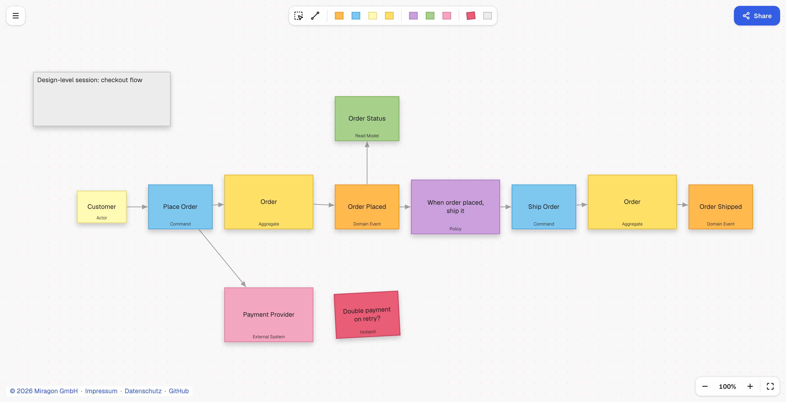

# Event Storming Modeler

[](LICENSE)
[](https://github.com/Miragon/event-storming-modeler/actions/workflows/ci.yml)
[](https://www.npmjs.com/package/@miragon/event-storming-renderer)
[](https://marketplace.visualstudio.com/items?itemName=miragon-gmbh.event-storming-modeler)

Create, edit and embed digital [Event Storming](https://www.eventstorming.com/) boards — a
TypeScript library, a VS Code extension, and a web app, all built on
[diagram-js](https://github.com/bpmn-io/diagram-js).

**[Try the web app →](https://event-storming.modeler.miragon.io)**



## Install

```bash
npm install @miragon/event-storming-renderer
```

```ts
import { NavigatedViewer } from '@miragon/event-storming-renderer';
import '@miragon/event-storming-renderer/assets/event-storming.css';

const viewer = new NavigatedViewer({ container: document.querySelector('#canvas')! });

await viewer.importDSL(`title Order Checkout
actor Customer [80, 300]
command Place Order [240, 300]
aggregate Order [420, 290]
event Order Placed [620, 300]
Customer -> Place Order
Place Order -> Order
Order -> Order Placed`);

const board = viewer.exportMap(); // canonical JSON model
const dsl = viewer.exportDSL(); // back to .storm text
const { svg } = await viewer.saveSVG();
```

## What you get

- **Embeddable viewer & modeler** on diagram-js — palette, context pad, move/connect, inline
  labels, undo/redo, free canvas (no grid, no axes — just stickies on a timeline).
- **Lossless `.storm` DSL round-trip** and a deterministic JSON model.
- **VS Code extension** — a custom editor for `.storm` files in the shared Miragon modeler chrome
  ([`@miragon/modeler-shell`](https://www.npmjs.com/package/@miragon/modeler-shell)):
  menu, palette, zoom panel, problems pill; undo and redo through the VS Code document.
- **Collaborative-modeler contract** — the renderer implements
  [`@miragon/modeler-api`](https://www.npmjs.com/package/@miragon/modeler-api)
  (`createCollaborativeModeler`, `createCollaborativeViewer`).
- **Web app** — the same chrome on the web: a start screen, "Share" (the board travels in the
  link), open or drop `.storm`/`.json` files, PNG, SVG, JSON and `.storm` export, a problems list,
  and replacing a board with an undo toast instead of a confirmation.
- **Strict DOM-free core** (model, DSL, transforms) — usable in any JavaScript runtime.
- **Self-hosted fonts** — no CDN, offline-capable.

### Sticky notes

| Sticky          | DSL keyword | Default size | Fill      |
| --------------- | ----------- | ------------ | --------- |
| Domain Event    | `event`     | 130×90       | `#FFB84D` |
| Command         | `command`   | 130×90       | `#7EC8F0` |
| Actor           | `actor`     | 100×65       | `#FFF9B1` |
| Aggregate       | `aggregate` | 180×110      | `#FFE066` |
| Policy          | `policy`    | 180×110      | `#C9A0DC` |
| Read Model      | `readmodel` | 130×90       | `#A8D08D` |
| External System | `external`  | 180×110      | `#F4A6C0` |
| Hotspot         | `hotspot`   | 130×90       | `#E85D75` |
| Note            | `note`      | auto         | `#ECECEC` |

Plus freeform **drawings** (`line`) and labelled **arrows** (`->`) between stickies. Every sticky
accepts an optional `(color #hex)` override.

### Editor interactions

| Action                     | How                                                                                                                                                                                              |
| -------------------------- | ------------------------------------------------------------------------------------------------------------------------------------------------------------------------------------------------ |
| Multi-select (lasso)       | Palette tool, `L`, or `Shift` + drag on the empty canvas                                                                                                                                         |
| Draw lines/shapes          | Palette tool — click point by point; click the last point again (or double-click/`Enter`/`Esc`) to finish, click the start point to close; drag the handles of a selected drawing to move points |
| Quick create at the cursor | `E` domain event, `C` command                                                                                                                                                                    |
| Add to selection           | `Shift` + click on elements                                                                                                                                                                      |
| Copy / paste               | `Ctrl/Cmd+C`, `Ctrl/Cmd+V` — paste attaches to the cursor; click places, `Esc` cancels                                                                                                           |
| Duplicate (in place)       | `Ctrl/Cmd+D`                                                                                                                                                                                     |
| Nudge selection            | Arrow keys (`Shift` = coarse)                                                                                                                                                                    |
| Undo / redo                | `Ctrl/Cmd+Z` / `Ctrl/Cmd+Shift+Z` (in VS Code the document's own undo); in the web app `Ctrl/Cmd+Z` also takes back a replaced board while the canvas has nothing else to undo                   |
| Zoom                       | `Ctrl/Cmd` + `+` / `-`, `Ctrl/Cmd+0` sets 100%, `Shift+1` fits; controls bottom-right                                                                                                            |
| Open / save (web app)      | `Ctrl/Cmd+O` (or "Open a file…" on the start screen) opens a `.storm`, `.json` or `.txt` file, `Ctrl/Cmd+S` downloads the `.storm` file; a file dropped anywhere on the page opens               |
| All shortcuts              | Menu → "Keyboard shortcuts…"                                                                                                                                                                     |
| Edit label                 | Double-click a sticky (`Cmd/Ctrl+Enter` saves)                                                                                                                                                   |
| Format a note              | Bold/italic/bullets via the floating toolbar or `Cmd/Ctrl+B` / `Cmd/Ctrl+I`, text alignment via the toolbar's align buttons; stored as a tiny Markdown subset in the label                       |
| Append sticky              | Context pad `+` drags a blank sticky; pick the type in the popup that opens, then label it                                                                                                       |
| Change sticky type         | Context pad → change-type popup                                                                                                                                                                  |
| Type captions on/off       | Menu → "Type captions" (small kind caption at the bottom of every sticky; per-client view preference)                                                                                            |
| Recolor a drawing          | Context pad → color picker (stickies and notes keep their notation colors)                                                                                                                       |

## The `.storm` DSL

A line-based text format: `<kind> <Name> [x, y]` places a sticky (pixel coordinates, center),
`A -> B` connects two stickies by name (optional label after `;`). Unknown lines survive
round-trips untouched. An optional `level big-picture|process|design` statement records the
workshop level and filters which sticky kinds the editor offers for creation (absent = `design`,
everything available); existing elements of any kind stay valid on every level. An actor,
hotspot or note can be pinned onto a host sticky with the trailing `(on <Host Name>)` suffix —
it then moves together with its host:

```
command Approve Order [240, 300]
actor Manager [250, 280] (on Approve Order)
note Check with legal first [250, 340] (on Approve Order)
```

Notes auto-size to their text; a hand-resized note records its box with the trailing
`(size <w>x<h>)` suffix:

```
note Kickoff agenda [80, 80] (size 240x160)
```

Two stickies may carry the same label (e.g. the same aggregate appearing twice on the
timeline). An ambiguous name is disambiguated with the sticky's internal id: an `(id …)`
suffix on the declaration and `#id` in references (arrow endpoints and `(on …)` hosts) —
unambiguous boards keep referencing purely by name, without any ids in the text:

```
aggregate Order [420, 290] (id agg_order)
aggregate Order [1160, 290] (id agg_order_2)

Place Order -> #agg_order
#agg_order -> Order Placed
Ship Order -> #agg_order_2
#agg_order_2 -> Order Shipped
```

The full example board
([`example/order-checkout.storm`](example/order-checkout.storm)):

```
title Order Checkout

actor Customer [80, 300]
command Place Order [240, 300]
aggregate Order [420, 290] (id agg_order)
event Order Placed [620, 300]
policy When order placed, ship it [800, 300]
command Ship Order [980, 300]
aggregate Order [1160, 290] (id agg_order_2)
event Order Shipped [1340, 300]
readmodel Order Status [620, 120]
external Payment Provider [420, 520]
hotspot Double payment on retry? [620, 520]
note Design-level session: checkout flow [80, 80]

Customer -> Place Order
Place Order -> #agg_order
Place Order -> Payment Provider
#agg_order -> Order Placed
Order Placed -> Order Status
Order Placed -> When order placed, ship it
When order placed, ship it -> Ship Order
Ship Order -> #agg_order_2
#agg_order_2 -> Order Shipped
```

## Packages

| Package                                                         | Description                                                          |
| --------------------------------------------------------------- | -------------------------------------------------------------------- |
| [`@miragon/event-storming-schema-model`](packages/schema-model) | Board metamodel, Zod validation, deterministic JSON (DOM-free)       |
| [`@miragon/event-storming-dsl`](packages/dsl)                   | `.storm` text DSL ↔ model, lossless round-trip (DOM-free)            |
| [`@miragon/event-storming-transforms`](packages/transforms)     | Pure `EventStormingBoard → EventStormingBoard` transforms (DOM-free) |
| [`@miragon/event-storming-renderer`](packages/renderer)         | diagram-js renderer, viewer, import/export                           |
| [`apps/webapp`](apps/webapp)                                    | Web editor (demo, deployed on Netlify)                               |
| [`apps/vscode`](apps/vscode)                                    | VS Code extension for `.storm`                                       |

## Claude Code plugin

Two Claude skills — the Event Storming method and the `.storm` format — ship from this repository
as a Claude Code plugin, so you can use them in any project:

```
/plugin marketplace add Miragon/event-storming-modeler
/plugin install event-storming-modeler@event-storming
```

| Skill            | Covers                                                                                                 |
| ---------------- | ------------------------------------------------------------------------------------------------------ |
| `event-storming` | Brandolini's method: sticky grammar, the three workshop levels, facilitation, board reviews            |
| `storm-dsl`      | The `.storm` format: grammar, suffixes, coordinates and layout, per-level authoring rules, diagnostics |

Claude can then read, review, edit and generate `.storm` boards anywhere. Details in
[`plugins/event-storming-modeler/`](plugins/event-storming-modeler/); the marketplace manifest is
[`.claude-plugin/marketplace.json`](.claude-plugin/marketplace.json).

## Quickstart (development)

```bash
npm install
npm run build        # build all packages
npm test             # unit tests
npm run test:vscode  # the packaged VS Code extension in a real VS Code (opens a window briefly)
npm run dev:webapp   # run the web editor locally
```

See [CONTRIBUTING.md](CONTRIBUTING.md) for the full inner loop, browser/e2e tests, the VS Code
smoke test (locally and in CI) and the Portless dev URL setup.

## Fonts

The renderer ships no fonts and loads nothing from a CDN. The typeface is **Geist** (Miragon
corporate identity); provide it yourself — recommended self-hosted via
[`@fontsource`](https://fontsource.org/) (one variable file covers all weights):

```ts
import '@fontsource-variable/geist/wght.css';
```

Without a font the fallback chain degrades cleanly to system sans.

## Design tokens

The renderer CSS (`@miragon/event-storming-renderer/assets/event-storming.css`) carries the Miragon
design-system tokens (`--cd-*`) and their mapping onto diagram-js, vendored unchanged from the
`miragon-brand:modeler-tool-design` skill into
[`packages/renderer/src/theme/`](packages/renderer/src/theme/). The tokens sit in the cascade layer
`event-storming-tokens`, so a host page's own `--cd-*` tokens win. The diagram-js mapping
(`--bio-*` and the `.djs-parent` variables) applies page-wide, so every diagram-js or bpmn-js canvas
on the same page takes the Miragon roles too. The canvas is drawn light; exports are always light.

## Acknowledgements

Based on [wardley-maps-modeler](https://github.com/Miragon/wardley-maps-modeler).

## License

[MIT](LICENSE)
